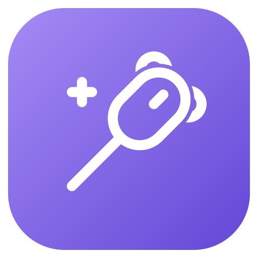
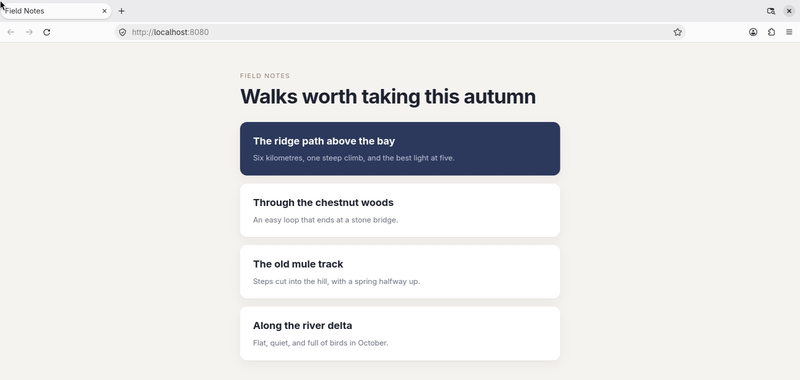

#  mousewand

Mouse gestures for Linux. Hold a mouse button, draw a stroke, and the window under the cursor gets the action you set for that stroke in that app.



It runs on Hyprland, KDE Plasma 6, GNOME, sway, niri, COSMIC, labwc and X11 desktops, and picks the right one on its own. A quick click of the trigger button is still a click, so middle-click paste keeps working, and holding the button still is still a drag.

## Install

Build it with a recent [Rust](https://rustup.rs) toolchain:

```fish
git clone https://github.com/tkutsu/mousewand
cd mousewand
cargo install --path crates/mousewand
```

mousewand reads your mice directly and passes their events on through a virtual mouse. This udev rule lets the logged-in user do that without root:

```fish
sudo cp dist/70-mousewand.rules /etc/udev/rules.d/
sudo cp dist/mousewand-uinput.conf /etc/modules-load.d/
sudo modprobe uinput; and sudo udevadm control --reload; and sudo udevadm trigger
```

Log out and back in once. Being in the `input` group works too.

Run `mousewand`, hold the middle button and draw. Ctrl+C stops it and gives the mouse back.

To start it with your desktop, add `mousewand` to your compositor's autostart, such as `exec-once` in Hyprland, or use the systemd user service:

```fish
mkdir -p ~/.config/systemd/user
cp dist/mousewand.service ~/.config/systemd/user/
systemctl --user enable --now mousewand
```

Only one mousewand runs at a time, so doing both does no harm.

### Settings app

The settings app is optional. It's a Tauri app and needs WebKitGTK (`webkit2gtk-4.1`), Node and pnpm to build:

```fish
pnpm -C crates/mousewand-settings/ui install
pnpm -C crates/mousewand-settings/ui build
cargo install --path crates/mousewand-settings
```

Draw a circle over a window to open it on that window's app. `mousewand-settings --class firefox` opens it from a terminal. It edits the same files described below, keeps your comments, and won't save a config mousewand would reject. It can also record a shortcut or detect your trigger button as you press them, offer ready-made actions like Back or Close tab, and teach mousewand new shapes.

## Configuration

```
~/.config/mousewand/
  config.toml         settings, gestures for every app, global gestures, hints
  apps/<class>.toml   gestures for one app, by window class
  shapes/<name>.toml  shapes drawn in the settings app
  themes/<name>.toml  trail themes
```

Changes apply when you save. If a file has an error, mousewand keeps the last working config and shows the error in a notification.

The examples set up Firefox, kitty, volume on the wheel, an alt-tab and hints. Their two workspace gestures use Hyprland dispatchers.

```fish
mkdir -p ~/.config/mousewand
cp -r examples/* ~/.config/mousewand/
```

### Gestures

A gesture is an input and an action, with an optional name for hints to show:

```toml
# ~/.config/mousewand/apps/firefox.toml
match = ["firefox", "librewolf"]

[[gesture]]
stroke = "L"
name = "Back"
action = { keys = "alt+Left" }
```

Without `match`, an app file applies to the window class in its file name. An app's gestures replace the ones in `config.toml` that have the same input.

The input is one of these:

- `stroke = "DR"`: directions in the order you draw them. `U`, `D`, `L` and `R`, and diagonals as numpad digits: `7` up-left, `9` up-right, `1` down-left, `3` down-right.
- `shape = "circle"`: a drawn shape. See [Shapes](#shapes).
- `wheel = "up"`: a wheel notch while you hold the trigger, `up`, `down`, `left` or `right`. It fires on every notch.
- `click = "right"`: a `left` or `right` click while you hold the trigger. With `right` as the trigger, only `left`.

A stroke or shape can also need keys held on the keyboard, so one stroke can do two things. See [Modifiers](#modifiers).

The action is one of these:

- `keys = "ctrl+shift+t"`: a key combo for the window you drew over. Keys are positions on a US keyboard, whatever your layout.
- `command = "..."`: a shell command. It gets `$MOUSEWAND_CLASS` and `$MOUSEWAND_TITLE`, and the selected text in `$SELECTION`. See [Using the selected text](#using-the-selected-text).

- `dispatch = "..."`: a compositor command. See [Desktops](#desktops) for what each one takes.

An action can also be a list of steps, run one after another. Each step waits for the one before it to finish, a command for up to 3 seconds, and `wait` pauses for that many milliseconds:

```toml
[[gesture]]
stroke = "UR"
name = "Duplicate tab"
action = [{ keys = "ctrl+l" }, { wait = 50 }, { keys = "alt+Enter" }]
```

A stroke can keep firing while you hold the trigger. With `repeat = true` it fires when it's recognized, again for every `step` pixels (80 by default) you keep moving in its last direction, and on every wheel notch, which suits scrubbing through tabs. With `hold` in the action it does the same and holds those keys down until you let go, which makes a real alt-tab:

```toml
[[gesture]]
stroke = "9"
name = "Switch windows"
action = { keys = "Tab", hold = "alt" }
```

A repeating stroke takes over as soon as it's drawn, so no other stroke may start with it. mousewand rejects a config where one does.

### Shapes

A shape matches by how the drawing looks rather than its directions. A circle counts when it's squashed, tilted, drawn either way round, or not quite closed.

`circle`, `triangle`, `square`, `star`, `heart`, `check`, `spiral` and `infinity` are built in. To add a shape, draw it five times in the settings app. It saves the shape as `shapes/<name>.toml` and lists every shape under Shapes, where you can redraw or remove the ones you drew.

```toml
[[gesture]]
shape = "circle"
name = "Reopen tab"
action = { keys = "ctrl+shift+t" }
```

Shapes fire on release and can't repeat or hold keys. A stroke with a gesture of its own takes precedence over a shape. Among shapes, a drawing matches the one it looks most like, but only shapes some gesture uses compete: with just `circle` in use, a square is round enough to count as a circle.

### Modifiers

With `with`, a stroke or shape only fires while those keys are held on the keyboard, and the same stroke without them can do something else:

```toml
[[gesture]]
stroke = "L"
name = "Back"
action = { keys = "alt+Left" }

[[gesture]]
stroke = "L"
with = "shift"
name = "Previous tab"
action = { keys = "ctrl+shift+Tab" }
```

`with` takes `ctrl`, `shift`, `alt` and `super`, joined with `+`, and the keys must match exactly. Only strokes and shapes that fire on release can use it. Their keys are typed once you let go of the modifiers too, so Shift doesn't turn `ctrl+t` into `ctrl+shift+t`.

mousewand needs to read the keyboard to know what's held. It only asks which keys are down at the moment a gesture fires, and never reads what you type, but the access it needs would let any program you run read your typing. That's why this udev rule is separate, and only worth installing if you use `with`:

```fish
sudo cp dist/71-mousewand-keyboard.rules /etc/udev/rules.d/
sudo udevadm control --reload; and sudo udevadm trigger
```

Being in the `input` group works too.

### Turning gestures off

Gestures are off over games, and over anything else that wants the button for itself. There the trigger is an ordinary button, and so is the `[global]` trigger. `[off]` in `config.toml` lists such windows by class. `*` matches any run of characters and `?` matches one, ignoring case. `games`, on by default, covers Steam games run through Proton (`steam_app_*`), anything run through Wine (`*.exe`) and gamescope. Native Linux games have classes of their own, so list those:

```toml
[off]
games = true
match = ["blender", "org.gnome.*"]
```

The General page of the settings app edits the same list. An app file can also turn its app off:

```toml
# ~/.config/mousewand/apps/blender.toml
enabled = false
```

`mousewand toggle` pauses gestures everywhere, and running it again resumes them. Bind it to a keyboard shortcut in your desktop's settings.

### Global gestures

Gestures under `[global]` are the same in every app, and app files can't replace them. With a `trigger` of their own, that button runs only them, and the main trigger keeps the app gestures:

```toml
[global]
trigger = "back"     # optional; without it they share the main trigger

[[global.gesture]]
stroke = "RU"
name = "Next workspace"
action = { dispatch = 'hl.dsp.focus({ workspace = "e+1" })' }
```

On their own button, `keys` go to the focused window rather than the one under the cursor.

### Settings

These are the defaults:

```toml
trigger = "middle"   # middle, right, back (mouse 4), forward (mouse 5), mouse6 to mouse8
threshold = 8        # pixels to move before a press becomes a gesture
hold_ms = 300        # holding still this long makes it a normal press
cancel_ms = 0        # holding still this long mid-stroke cancels it, e.g. 700; 0 never does
min_segment = 30     # shorter strokes are ignored as noise
devices = []         # only use mice whose name contains one of these
theme = "default"    # a built-in theme, or a file in themes/ without .toml
open_settings = { shape = "circle" }   # or a stroke, like { stroke = "U39D" }
```

### Hints

Hints show the stroke so far as arrows, what it could still become, and the name of the gesture that fired. A wheel or click gesture shows a mouse with its wheel or button lit, and one that fires again and again, a repeat or the wheel, counts up: "Next tab 3×". Before you draw anything, the list of what you could do includes the wheel and click gestures. Hints fade out with the trail. They're off until you turn them on, under Appearance in the settings app, which also picks a style and shows an example.

```toml
[hint]
enabled = true
next = true                  # list what the stroke could still become
position = "bottom center"   # top, center or bottom, with left, center or right
margin = 64                  # pixels from the screen edge
font = "sans-serif"          # any installed font family
size = 17                    # text size in pixels
text = "#f2f2f7"
glyph = "#9ec4ff"            # the arrows, mice and counts
failed = "#ff5959"           # arrows once the stroke matches nothing
background = "#1c1e26"       # "#rrggbbaa" for a see-through background
opacity = 0.9
padding = 14
radius = 14
```

### Themes

Built in:

- Cool: default, ocean, aurora, mint, matrix
- Warm: ember, fire, sunset, gold
- Soft: sakura, cotton-candy, lavender
- Lines: laser, ink
- Bright: neon, rainbow
- Flags: pride, trans
- Desktop color schemes: catppuccin, dracula, gruvbox, nord, tokyo-night

To make your own, add a file to `themes/`. A file with a built-in name replaces that theme.

```toml
# ~/.config/mousewand/themes/ember.toml
color = "#ff8a3d"     # the trail
rejected = "#7f8ca3"  # the trail when nothing matched
width = 34            # pixels at the head, glow included
life_ms = 650         # how long the tail lingers
fade_ms = 400         # fade after release
glow = 0.9            # 0 is a plain line
```

For a gradient, list colors from head to tail:

```toml
color = ["#ffd36e", "#ff8a5c", "#e85d8a", "#7b4bb7"]
```

### Using the selected text

A command that mentions `$SELECTION` gets the text you last selected in it, read as the gesture fires. That's the primary selection, which selecting text sets without copying it, from whichever window you selected in. mousewand reads it with `wl-paste` on Wayland and `xclip` on X11, so one of them has to be installed.

```toml
[[gesture]]
stroke = "UR"
name = "Copy selection"
action = { command = 'printf %s "$SELECTION" | wl-copy' }

[[gesture]]
stroke = "UL"
name = "Search selection"
action = { command = 'xdg-open "https://duckduckgo.com/?q=$(printf %s "$SELECTION" | jq -sRr @uri)"' }
```

## Desktops

| | Gestures go to | `dispatch` runs |
|---|---|---|
| Hyprland | the window under the cursor | a dispatcher: `'hl.dsp.focus({ workspace = "e+1" })'` with a Lua config, `"workspace e+1"` before |
| KDE Plasma 6 | the window under the cursor | a KWin shortcut by name, like `"Window Maximize"` |
| GNOME | the window under the cursor | nothing |
| X11 (Xfce, Cinnamon, MATE, i3 and others) | the window under the cursor | nothing |
| sway | the focused window | a sway command, like `"fullscreen toggle"` |
| niri | the focused window | a niri action, like `"maximize-column"` |
| COSMIC, labwc | the focused window | nothing |

sway, niri, COSMIC and labwc don't tell other programs which window is under the cursor, so gestures go to the focused one. With focus-follows-mouse on, that's the same window.

On start, mousewand sets up what it can:

- Hyprland: it turns off the layer animation for its trail in the running session, and again after each config reload.
- GNOME: it installs and enables its Shell extension, which draws the trail. GNOME loads new extensions at login, so log out and back in once.
- niri: it adds `focus-follows-mouse` to `config.kdl` once, after `niri validate` accepts the change, and keeps the old file as `config.kdl.mousewand-backup`.
- X11: it starts picom for the trail if no compositing manager is running, and stops it on exit.

It tells you once about anything left to do by hand, like focus-follows-mouse in labwc or COSMIC, in the settings app or in a notification. To pick a backend yourself, set `MOUSEWAND_BACKEND` to `hyprland`, `sway`, `niri`, `kwin`, `gnome`, `x11` or `toplevel`.

## Troubleshooting

The log is in `journalctl --user -u mousewand -f`, or in the terminal if you run `mousewand` there. `RUST_LOG=mousewand=debug` adds the window class each gesture matched and the stroke it saw.

### Nothing happens

The log should say `grabbed` and your mouse's name. If it doesn't, or it asks whether `/dev/uinput` is writable, the udev rule hasn't taken effect yet: log out and back in. With several mice, check that `devices` in `config.toml` includes yours.

### A stroke does nothing

The log shows what mousewand saw, like `DUDU: no gesture`. Draw more slowly, or lower `min_segment`.

### The wrong window reacts

On sway, niri, COSMIC and labwc, gestures go to the focused window. Turn on focus-follows-mouse.

### No trail

On GNOME, log out and back in once after the first start. On X11, mousewand needs picom or another compositing manager. Anywhere else, look for `no trail:` in the log. The trail needs a working GPU driver.

### Gestures start when I meant to click or drag

A click stays a click unless you draw a stroke, and holding still for `hold_ms` makes a normal press, for middle-drag and autoscroll. If quick flicks still turn into strokes, raise `min_segment`.

### A gesture with Shift or Ctrl does nothing

The log says `can't read the keyboard` once if mousewand can't see which keys are held. Install the rule in [Modifiers](#modifiers), then log out and back in. A gesture `with = "shift"` doesn't fire while Ctrl is held too.

### A stroke I gave up on fired anyway

With `cancel_ms` set, holding still that long cancels a stroke, and the hint says "Cancelled". A repeating gesture that has already taken over doesn't cancel.

### A circle does something else


A stroke with a gesture takes precedence over a shape, and a repeating stroke takes over as soon as it's drawn. Debug logging shows which stroke your circle made.

### Rings pulse around the cursor

A repeating gesture took over, and each ring is one repeat. A one-direction repeating stroke, like the example alt-tab on `9`, catches every stroke that starts in that direction. Give it a longer stroke.

### My mouse settings stopped applying

The compositor now sees one virtual mouse, "mousewand virtual mouse". Apply per-device settings, like an acceleration profile, to it.

### Keys come out wrong

`keys` uses US key positions. On another layout, write the key in the same place on a US keyboard.

### No hints

Hints are off by default. Turn them on under Appearance in the settings app, or set `enabled = true` under `[hint]`. If hints show arrows but no text, the `font` isn't installed. `fc-match "Font Name"` shows what it resolves to.

### "already a [global] gesture"

An app file uses the same input as a global gesture that shares the main trigger. Change one of them, or give `[global]` its own `trigger`.

### "there's no `kind` here", or `hold` or `rocker`

The gesture format changed. `kind = "repeat"` is now `repeat = true`, `hold` goes in the action, and `rocker` is now `click`.

### The mouse is stuck

Stopping mousewand gives it back: `systemctl --user stop mousewand`, or `pkill mousewand`.

## Testing

`cargo test` runs the unit tests for recognition, the config and the gesture state machine.

The settings app has its own tests, run from its folder. The first time, `pnpm exec playwright install chromium` fetches the browser they use.

```fish
cd crates/mousewand-settings/ui
pnpm test        # the TypeScript logic, with Vitest
pnpm test:ui     # clicking through the app in Chromium, against a fake backend
pnpm test:look   # every page, light and dark, against the shots in e2e/look/
```

After a change meant to alter how a page looks, `pnpm test:look --update-snapshots` takes new shots.

### On every desktop

`tools/vm/vm.sh` runs mousewand end to end in a throwaway Arch VM on Hyprland, sway, KDE, GNOME, niri, labwc, COSMIC and X11. A fake mouse inside the guest draws over two terminal windows, and the suite checks what each gesture did: per-app gestures, keys, lists of steps, repeating and held keys, the wheel, clicks, shapes, modifiers, pausing, config reloads, click replay, `$SELECTION` and `dispatch`. It needs qemu with KVM and 8 GB of free memory.

```fish
tools/vm/vm.sh setup       # once: download the image
tools/vm/vm.sh start       # boot; the first boot installs the desktops
tools/vm/vm.sh test        # every desktop, or some: tools/vm/vm.sh test sway kwin
tools/vm/vm.sh stop
```

Each run also takes screenshots of the trail and the hint in the middle of a stroke. Subtracting the shot taken just before the stroke leaves only what mousewand drew, and that must match what it drew on Hyprland: the same place, shape and color, within a tolerance, since GNOME and X11 draw with their own code. `~/.cache/mousewand-vm/report.html` shows each desktop's drawing beside Hyprland's. The VM's Hyprland takes its look from `settings.lua`, `decoration.lua` and `animation.lua` in your `~/.config/hypr/configs/`, if they're there.

If port 2222 is taken, set `MOUSEWAND_VM_PORT` to another one.

## License

MIT or Apache-2.0, at your option.
