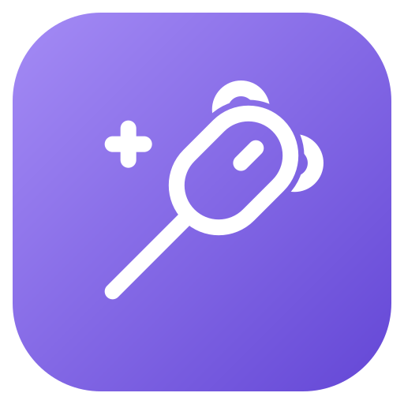
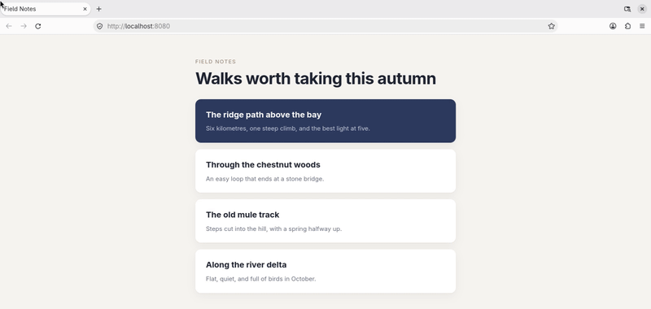

#  mousewand

Mouse gestures for Linux. Hold a mouse button, draw a stroke, and the window under the cursor gets the action you set for that stroke in that app.



It runs on Hyprland, KDE Plasma 6, GNOME, sway, niri, COSMIC, labwc and X11, and picks the right one on its own. A quick click is still a click and holding still is still a drag, so middle-click paste keeps working.

## Install

You need a recent [Rust](https://rustup.rs) toolchain.

```sh
git clone https://github.com/tkutsu/mousewand
cd mousewand
cargo install --path crates/mousewand
```

mousewand reads your mice and passes their events on through a virtual mouse. Let your user do that without root, then log out and back in once:

```sh
sudo cp dist/70-mousewand.rules /etc/udev/rules.d/
sudo cp dist/mousewand-uinput.conf /etc/modules-load.d/
sudo modprobe uinput&& sudo udevadm control --reload&& sudo udevadm trigger
```

## Run

Run `mousewand`, hold the middle button and draw. Ctrl+C stops it and gives the mouse back.

To start it with your desktop, use the systemd user service:

```sh
mkdir -p ~/.config/systemd/user
cp dist/mousewand.service ~/.config/systemd/user/
systemctl --user enable --now mousewand
```

On Hyprland you can start it from your Lua config instead:

```lua
hl.on("hyprland.start", function()
  hl.exec_cmd("mousewand")
end)
```

## Set up gestures

Copy the examples to get gestures for Firefox and kitty, volume on the wheel and an alt-tab:

```sh
mkdir -p ~/.config/mousewand
cp -r examples/* ~/.config/mousewand/
```

A gesture is a stroke and an action. Strokes are directions in the order you draw them: `U`, `D`, `L`, `R`, and numpad digits for diagonals (`9` is up-right). This one goes back in Firefox:

```toml
# ~/.config/mousewand/apps/firefox.toml
[[gesture]]
stroke = "L"
name = "Back"
action = { keys = "alt+Left" }
```

Changes apply when you save. Shapes, wheel and click gestures, commands, themes and hints are all in the [configuration guide](docs/configuration.md).

### Settings app

The settings app is optional. It needs WebKitGTK (`webkit2gtk-4.1`), Node and pnpm to build:

```sh
pnpm -C crates/mousewand-settings/ui install
pnpm -C crates/mousewand-settings/ui build
cargo install --path crates/mousewand-settings
```

Draw a circle over a window to open it for that app. It edits the same files and won't save a config mousewand would reject.

### Modifiers

A gesture with `with = "shift"` only fires while Shift is held. To see which keys are held, mousewand needs this extra rule. It never reads what you type, but the access would let any program you run read your typing, so only install it if you use `with`:

```sh
sudo cp dist/71-mousewand-keyboard.rules /etc/udev/rules.d/
sudo udevadm control --reload&& sudo udevadm trigger
```

## Troubleshooting

Watch the log with `journalctl --user -u mousewand -f`. `RUST_LOG=mousewand=debug` also shows the stroke it saw and the window it matched.

- Nothing happens: the log should say `grabbed` and your mouse's name. If not, log out and back in so the udev rule applies.
- The wrong window reacts: on sway, niri, COSMIC and labwc, gestures go to the focused window, so turn on focus-follows-mouse.
- The mouse is stuck: `systemctl --user stop mousewand` or `pkill mousewand` gives it back.

The [troubleshooting guide](docs/troubleshooting.md) covers the rest. To run the tests, see [testing](docs/testing.md).

## License

MIT or Apache-2.0, at your option.
